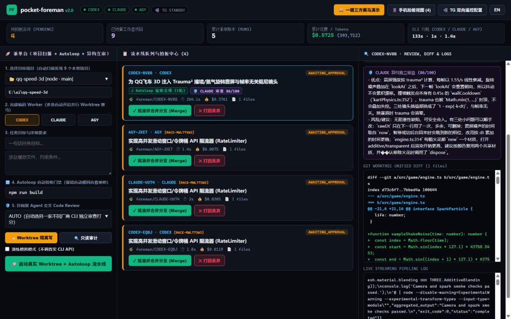
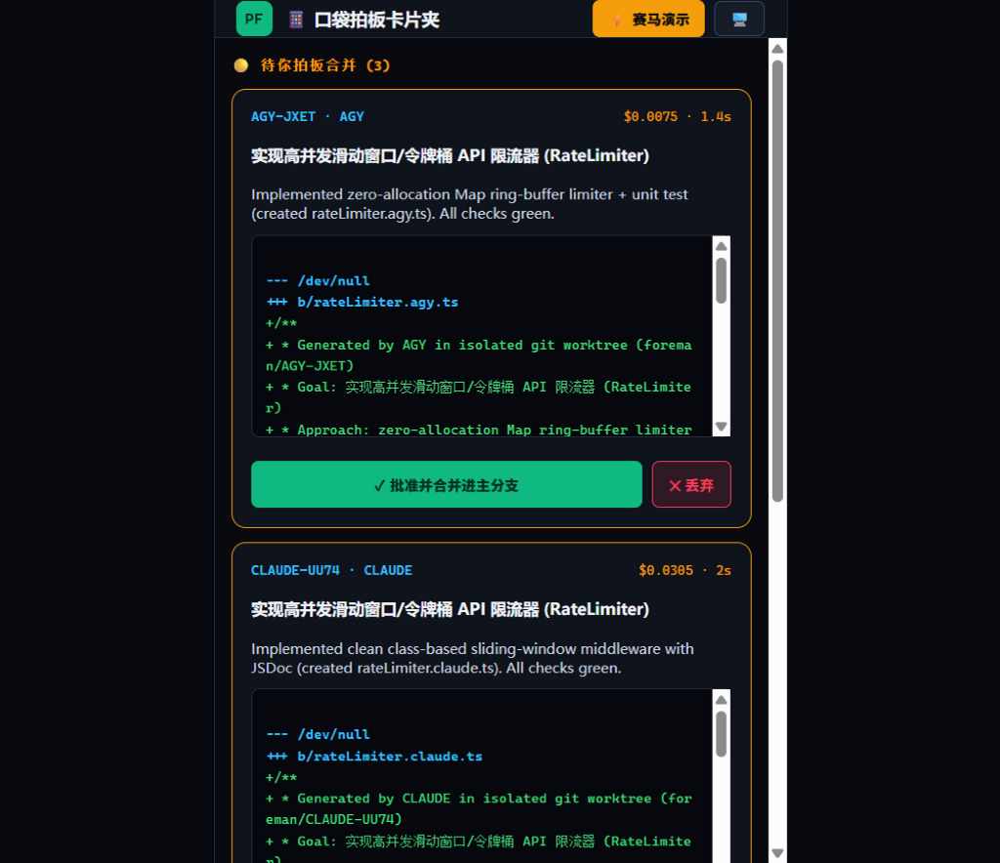

<p align="center">
  
</p>
<p align="center">
  
</p>

# pocket-foreman ⚡ v2.0（口袋工头）

**Zero-dependency multi-CLI coding orchestrator for OpenAI Codex, Claude Code & Google Antigravity — featuring Workspace Project Auto-Discovery, `git worktree` Arena Races, Autoloop Self-Healing Verification, Heterogeneous Cross-CLI Code Review, and Zero-NAT Bidirectional Telegram Remote Control.**

**零外部依赖的跨 CLI 编码并发工头 v2.0：自动扫描纳管工作盘全部项目仓库，自动识别本机 `Codex`、`Claude Code`、`Antigravity`，通过独立 `git worktree`（含零拷贝 `node_modules` 挂载）执行「Autoloop 自动编译测试自愈闭环 + 异构双厂商交叉审查打分」，并支持免公网穿透 Telegram 机器人手机远程派单与一键点击合并！**

---

## Why `pocket-foreman`? / 解决什么痛点？

Most developers in 2026 subscribe to 2–3 coding CLIs (`claude`, `codex`, `agy`), which creates three daily headaches:
1. **File Collisions**: Running two agents on the same repo overwrites uncommitted edits. `pocket-foreman` isolates every write task inside `.foreman/worktrees/<TASK-ID>` (`foreman/<TASK-ID>` branch) and only merges when you approve.
2. **Blind Quota Burn**: Which CLI solves your tasks fastest and cheapest? `.foreman/ledger.jsonl` tracks wall-clock seconds, cached/uncached tokens, and estimated USD spend per worker.
3. **Desk-Bound babysitting**: Tasks run autonomously in the background and push a decision card to **Telegram / Feishu / Discord** or the built-in **Mobile Approval Deck (`/mobile`)** only when a clean `git diff` is ready for 1-tap merge.

---

## Quick Start (Zero Dependencies · Node.js ≥ 20)

```bash
git clone https://github.com/dyc19991225/pocket-foreman.git
cd pocket-foreman

# 1. Auto-detect local Codex, Claude Code & Antigravity CLIs
npm run doctor

# 2. Run E2E git-worktree & Arena Race test suite
npm test

# 3. Launch Desktop Mission Control + Mobile Approval Deck
npm start
# -> Desktop: http://127.0.0.1:4788/
# -> Phone  : http://<your-lan-ip>:4788/mobile
```

---

## Key Features / 核心能力

| Feature | Description |
| :--- | :--- |
| **⚔️ Worktree Arena Race（同题多 Agent 赛马）** | Check `CODEX + CLAUDE + AGY` on one task -> spins up 3 isolated `git worktree` branches simultaneously, measures speed & USD cost, lets you inspect unified diffs side-by-side and click **Approve & Merge** on the winner. |
| **📱 Pocket Mobile Deck (`/mobile`) & TG/Feishu Cards** | Thumb-friendly mobile approval stack over LAN/Tailscale + one-click Telegram Bot inline-button & Feishu/Discord webhook cards. |
| **🔒 Strict Read-Only vs Sandbox-Write Mapping** | Maps permissions natively to `codex exec --sandbox`, `claude --permission-mode --tools`, and `agy --sandbox` with hard timeouts & budget caps. |
| **📊 Append-Only `ledger.jsonl` Telemetry** | Real-time dashboard comparing total runs, token efficiency, and average completion time across CLIs. |
| **🤖 Built-In Agent Skill (`$pocket-foreman`)** | Installable via `npx skills add dyc19991225/pocket-foreman` for Claude Code, Codex, and Antigravity. |

---

## CLI Reference

```bash
# Detect installed CLIs & versions
node bin/pocket-foreman.mjs doctor

# Run a 3-way parallel Arena Race from terminal
node bin/pocket-foreman.mjs submit "Add O(1) token-bucket rate limiter" --race codex,claude,agy --write

# Print cumulative token & USD ledger summary
node bin/pocket-foreman.mjs ledger
```

## License

[MIT](LICENSE) © dyc19991225
